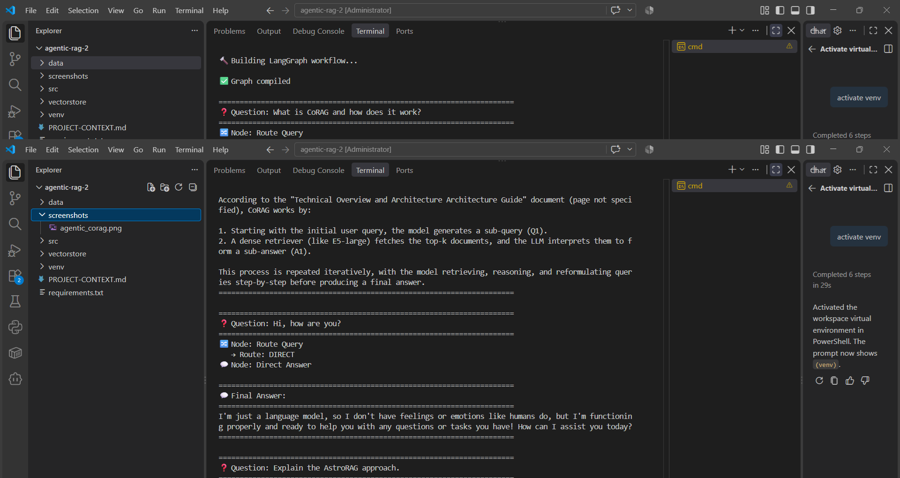
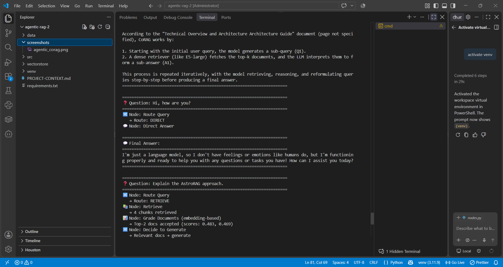
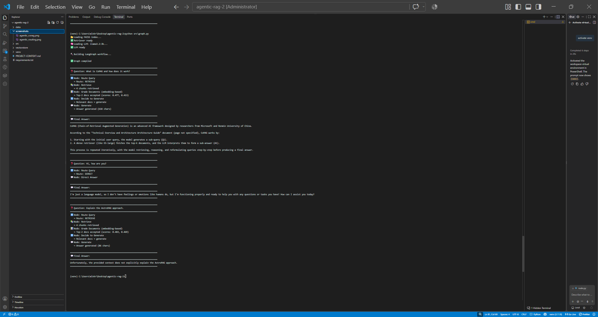

# 🤖 Agentic RAG Research Assistant

An **Agentic RAG** system using **LangGraph** where the LLM autonomously decides retrieval strategy, performs document grading, and self-corrects through query rewriting.

## 🎯 Features

- **Agentic Routing** — LLM decides: retrieve from docs or direct answer
- **Embedding-based Document Grading** — cosine similarity filtering (top-2)
- **Query Rewriting** — automatic query improvement on low relevance
- **Self-Correction** — max 2 retries with rewrite loop
- **Source Citations** — document name + page number
- **Zero API Cost** — local LLM (llama3.2:3b via Ollama)

## 🏗️ Architecture

```
User Query
   ↓
[Router] → RETRIEVE or DIRECT?
   ↓
[Retrieve] → FAISS top-4 chunks
   ↓
[Grade Documents] → Embedding-based top-2 accept
   ↓
[Decide to Generate] → relevant? → generate : rewrite
   ↓                              ↓
[Generate] ← [Rewrite Query] ← (retry max 2)
   ↓
Answer + Citations
```

## 🛠️ Tech Stack

| Component | Tool |
|-----------|------|
| Framework | LangGraph, LangChain |
| LLM | Ollama (llama3.2:3b) |
| Embeddings | all-MiniLM-L6-v2 |
| Vector DB | FAISS |

## 📸 Screenshots

### CoRAG Question + Full Answer


### Router — Direct Answer for Greeting


### Full Agentic Workflow (3 questions)


## 🚀 Setup

```bash
git clone <your-repo>
cd agentic-rag
py -3.11 -m venv venv
venv\Scripts\activate
pip install -r requirements.txt
ollama pull llama3.2:3b
python src/ingest.py
python src/graph.py
```

## 📁 Project Structure

```
agentic-rag/
├── src/
│   ├── state.py        # State schema
│   ├── nodes.py        # 6 agent nodes
│   ├── graph.py        # LangGraph workflow
│   └── ingest.py       # PDF → FAISS
├── data/pdfs/          # 4 RAG papers
├── vectorstore/        # FAISS index
├── screenshots/        # Demo screenshots
└── requirements.txt
```

## 📝 License

MIT